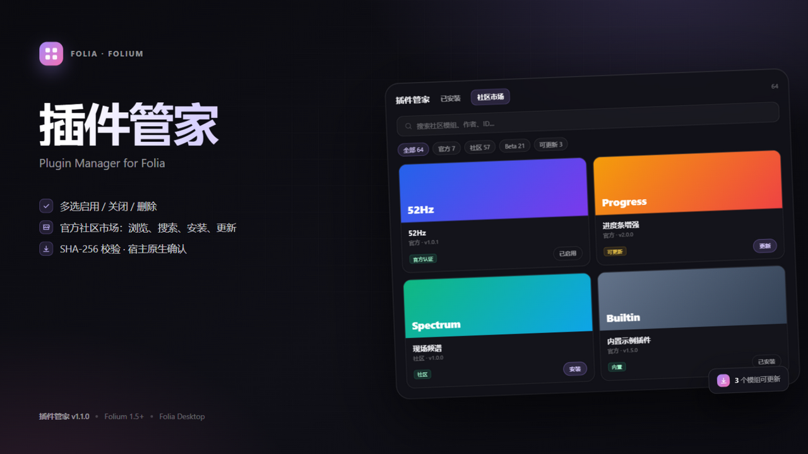

# 插件管家（plugin-manager）

Folia 的 Folium 模组管理器。在首页里管理已安装的模组，并内置官方社区市场（folium-compound）：
浏览、搜索、安装、更新和启用都可以在同一个页面里完成。

  



## 功能

页面顶部有「已安装」和「社区市场」两个标签。

### 已安装

- **多选**：每行一个复选框，支持全选 / 取消全选、按名称 / ID / 作者 / 描述搜索。
- **批量启用**：通过 Folia 自己的 `setModEnabled` 接口执行，保留加载器的原生启用确认与内容绑定，不绕过信任模型。
- **批量关闭**：逐个停用，立即生效。
- **批量删除**：只删除用户插件目录（`userData/mods`）里的插件；删除前二次确认，可选择同时清理该插件的数据与缓存。
- **状态一目了然**：已启用 / 已停用 / 加载出错 / 依赖缺失 / 需重新确认 / 文件损坏 / 位置冲突，并显示官方认证、先行测试、未验证、内置/仓库来源等标记。
- 批量操作栏在搜索栏旁边显示，不会遮挡播放器底栏。

### 社区市场

- 读取官方市场目录 `https://folium-compound.cielaniska.top/catalog.json`，展示官方、社区和先行测试（Beta）模组。
- 卡片显示封面、名称、作者、版本、包大小、来源和安装状态；点开卡片可以看完整简介、权限、依赖、签名时间和官网/源码入口。
- **安装 / 更新**：Node 端下载 zip 并核对目录里的 SHA-256，校验通过后交给宿主自己的 `installModFromZip` 解压、暂存和安装；安装完成后调用 `setModEnabled` 自动启用，仍会弹出宿主原生的确认窗口。
- **全部更新**：按顺序逐个更新有新版的可更新模组，避免并发安装互相打断。
- 筛选：全部 / 官方 / 社区 / Beta / 可更新 / 已安装，并支持名称、ID、作者、说明搜索。
- 离线：目录带 ETag 和本地缓存；网络失败时退回上次目录，并在顶部标明缓存时间，可点「重试」重新读取。

## 安装

### 方式一：下载发布包（推荐）

1. 打开 Folia「设置 → 模组」，开启「模组系统」。
2. 从 [Releases](https://github.com/cbylq23/folia-plugin-manager/releases/latest) 下载 `plugin-manager.zip`，拖进模组面板；或解压后把 `plugin-manager` 文件夹放进用户模组目录。
3. 在列表里找到「插件管家」，点击启用。它是未签名模组，Folia 会显示「未验证」并弹出一次原生确认窗口。
4. 回到首页，导航末尾会出现「插件管家」页面；也可以在命令面板里运行「打开插件管家」。

用户模组目录通常是：

- Windows：`%APPDATA%\Folia\mods`
- macOS：`~/Library/Application Support/Folia/mods`
- Linux：`~/.config/Folia/mods`

（以 Folia 的「设置 → 模组 → 打开插件目录」打开的路径为准。）

### 方式二：从源码安装

把本仓库克隆或下载到用户模组目录，文件夹命名为 `plugin-manager`，然后在「设置 → 模组」里启用：

```bash
cd %APPDATA%\Folia\mods
git clone https://github.com/cbylq23/folia-plugin-manager.git plugin-manager
```

（也可以直接把本仓库根目录作为模组目录；根目录已有 `mod.json`。）

## 使用

1. 打开首页的「插件管家」，或在命令面板运行「打开插件管家」。
2. 在「已安装」标签里勾选插件（点击行或复选框都可以）。搜索栏旁边会出现批量操作栏，实时显示可启用 / 可关闭 / 可删除的数量。
3. 点击「启用」「关闭」或「删除」：
   - **启用**：Folia 会为每个插件弹出一次原生确认窗口；未验证插件需要你逐个确认。
   - **关闭**：不需要确认。
   - **删除**：弹出确认窗口，列出将删除的插件和会被跳过的内置/仓库插件。勾选「同时删除插件数据与缓存」会连同该插件的设置、密钥和缓存一起清理。
4. 切到「社区市场」：
   - 点卡片查看详情，点「安装」下载并安装；有新版时按钮变成「更新」。
   - 「全部更新 (N)」会按顺序更新所有可更新项。
   - 顶部筛选和搜索只影响市场卡片。
5. 单行右侧的开关也可以单独启用 / 关闭插件；「刷新」按当前标签刷新：已安装列表或市场目录。

## 为什么批量启用 / 安装会弹很多次窗口？

Folium 的安全模型要求：每个模组在启用前都必须在主进程的原生窗口里确认，且确认绑定到模组内容摘要。插件管家调用的是 Folia 自己的启用接口，因此**不会**、也不应该绕过这个确认。批量启用或市场安装 N 个插件就会有 N 次确认；点「取消」的插件会保持已安装但停用，方便你稍后重试。

## 市场安全与权限

- 唯一声明的权限是 **`filesystem.data`**：用于在 `api.storage.paths.cache` 里缓存目录、下载的安装包和封面数据。市场缓存位于 `userData/mods-cache/plugin-manager/`。
- 主入口只访问 `https://folium-compound.cielaniska.top`，且只接受 `/downloads/` 下的安装包地址；目录或下载地址不在这个域名下会被拒绝。
- 每个安装包都要和目录里的 SHA-256 完全一致才会交给宿主，校验失败直接丢弃，不会进入 `mods/`。
- 解压、体积上限、zip-slip 防护、暂存校验和失败回滚都由宿主自己的安装器完成；插件管家不直接往 `mods/` 写文件。
- 启用仍由宿主原生确认窗口把关；签名、权限和内容摘要由宿主核对。

## 删除的范围

- 只处理 `userData/mods` 下的用户安装副本。
- `resources/mods`（随应用发布）和开发版的仓库 `mods/` 目录只读展示，不能删除。
- 如果同一个模组 id 同时存在于仓库和用户目录，加载器只使用先扫到的那一份；插件管家会把无法安全判断安装位置的条目标为「位置冲突」并拒绝删除。
- 删除不可撤销。默认只删插件文件夹；勾选「同时删除插件数据与缓存」后还会删除 `userData/mods-data/<id>` 与 `userData/mods-cache/<id>`。

## 兼容性

- Folia 桌面版，Folium 1.5 及以上（使用 `homeTabs`）；`mod.json` 的 `folia` 范围为 `>=0.7.22`。
- 权限：`filesystem.data`（市场缓存与安装包下载）。
- 未签名；Folia 会显示「未验证」。启用前请审阅 `index.cjs` 与 `client.mjs`。

## 文件

```
mod.json      # 清单
index.cjs     # 主进程：扫描/删除已安装模组，市场目录、下载与哈希校验
client.mjs    # 首页完整页面：已安装管理 + 社区市场
preview.png   # 模组市场介绍图（1280×720）
NOTICE.md     # 参考项目与 MIT 许可
README.md
LICENSE
```

## 开发

```bash
node --check index.cjs
node --check client.mjs
```

官方目录与下载链路需要真实的 Node 20+ 环境；本仓库不包含开发用的模拟测试页。

## 参考

社区市场的目录读取、哈希校验与安装链路参考了 [zaixiaxingzhang/folia-mod-market](https://github.com/zaixiaxingzhang/folia-mod-market)（MIT）。许可声明见 [NOTICE.md](NOTICE.md)。

## 许可证

本项目使用 MIT 许可证，见 [LICENSE](LICENSE)。